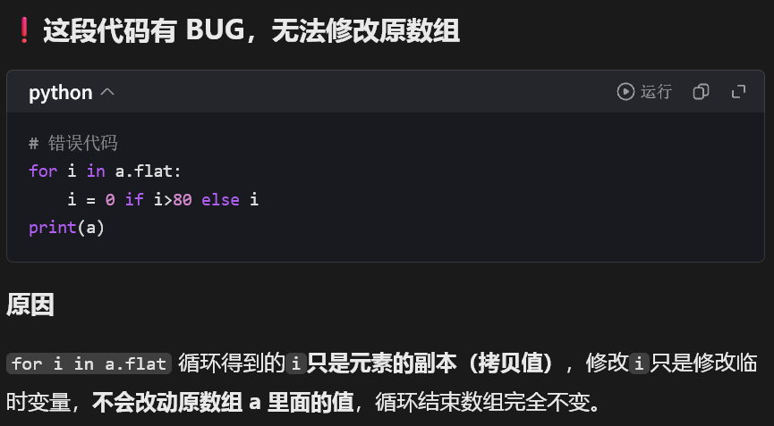

# ml\-0 作业学习总结

通过完整完成 Python 基础、文件处理、Numpy、PyTorch 四个模块的练习，我补齐了自己在 AI 实操中的细节基础，统一了机器学习常用工具的使用规范。

## 一、理解 Python 在机器学习中的定位

Python 并非以运行速度取胜，而是作为**调度语言**存在。底层数值计算依靠 C/C\+\+ 实现，Python 负责组织数据、调度逻辑、快速迭代模型。因此在机器学习场景下，**开发效率远重于单帧运行效率**，这也解释了 AI 领域统一使用 Python 的根本原因。

且python中有许多方便数据处理运算的库，比如numpy可以方便神经网络中权重与神经元数据的乘积，pandas方便整理数据，matplotlib方便可视化训练成果与过程等，极大地提升了机器学习的效率。

## 二、规范了文件读写与编码工程习惯

文件读取看似基础，但在真实数据任务中非常关键。本次练习让我彻底固化了**强制指定 utf\-8 编码**的习惯，一开始我是没有加encoding的，但是就报错了，然后我问了ai，它说需要强制指定UTF\-8编码避免 Windows 平台默认 GBK 带来的解码报错。我意识到机器学习数据预处理中，编码、路径、文件读取稳定性是工程落地的基础，细节错误会直接影响后续训练流程。

## 三、系统化巩固 Numpy 矩阵运算能力

虽然之前接触过 Numpy，但本次 10×10 矩阵全流程实操让我重新梳理了完整流程：随机矩阵初始化、单位矩阵性质、矩阵乘法、布尔索引筛选、矩阵分块统计均值。

一开始遍历$a.np$数组时我是用的for循环

```python
for i in a.flat:
    i=0 if i>80 else i
```

但是紧接着就发现并没有什么用，在询问了ai过后发现了低级错误，这只是for循环索引，修改`i`只是修改临时变量，**不会改动原数组 a 里面的值**，循环结束数组完全不变。



于是改用了numpy的特殊语法

```python
a[a>80]=0
```

通过numpy的练习，我熟练使用向量化操作处理矩阵数据，同时通过矩阵分块求均值，理解了**Numpy 向量化运算远优于逐元素循环**的底层优势，这是机器学习高效数据处理的核心思维。

## 四、打通 PyTorch 张量底层认知

本次 PyTorch 练习对我提升最大，纠正了我以往模糊的概念：

1\. 明确区分 **shape / dtype / device** 三大张量属性，清楚 CPU 与 GPU 设备差异与跨设备运算限制；

2\. 彻底掌握张量广播机制，理解不同维度张量自动扩容运算的规则，解决了深度学习维度报错的核心痛点；

3\. 熟练使用 `torch.cat` 进行维度拼接，清晰区分维度拼接规则与适用场景，能够独立判断张量能否按行、按列拼接。

这些内容是搭建模型、处理特征、维度变换的底层基础，本次训练让我的张量操作更加规范、精准。

## 五、建立清晰的机器学习入门体系认知

通过本次导学内容，我梳理了完整的 ML 入门链路：数学基础为底层、Python 与数据处理为工具、PyTorch 为实战框架。同时了解了算力平台、环境配置、换源、conda 环境管理等工程技能，让我后续的深度学习实验可以独立、完整落地。

## 六、个人收获与反思

本次作业整体难度不高，但**重在规范与体系化**。作为有编程基础的学生，我不再停留在“能跑就行”的阶段，而是开始培养机器学习所需要的**维度思维、向量化思维、数据优先思维**。本次练习夯实了我后续深度学习所需的全部底层工具，为接下来模型训练、特征工程、实验调参打下了扎实基础。

## ps

没看清提交要求，把这道题目文本解答也一并写到$jupyter$上面了,md文件只写了这次的学习总结= =
