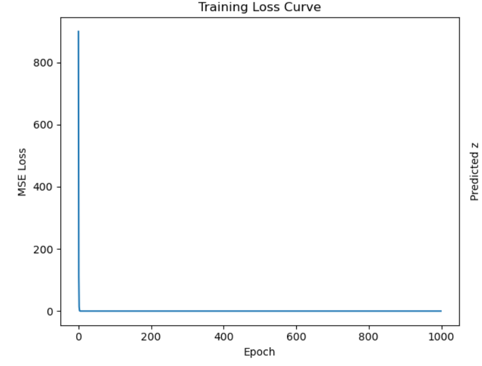
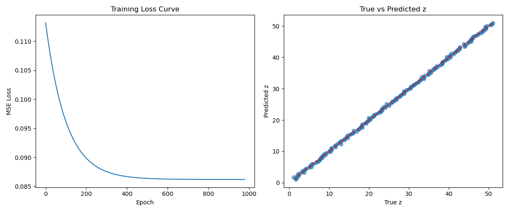

# 1.基础的线性回归

## Part 1: 核心概念理解（简答题）

### 1.1 什么是梯度？

1. **梯度的数学定义（二元函数 $f(x,y)$）**
   梯度是多元函数在某一点处，由函数对各个自变量的偏导数构成的向量，是所有方向导数的最大值。
   对于二元函数 $f(x,y)$，梯度记作：

   $$
   \nabla f(x,y) = \left( \frac{\partial f}{\partial x},\ \frac{\partial f}{\partial y} \right)
   $$

   $\nabla$ 为nabla算子，代表梯度算子。

   > 上面这个公式是ai生成的，因为我不会在md文档中打数学公式

2. **梯度的几何意义**
   梯度向量的方向，是**函数值上升速度最快的方向**；梯度向量的模长，代表该方向上函数的变化率。
   负梯度方向 $-\nabla f$ 就是函数值下降最快的方向。

3. **梯度在机器学习中的角色**
   机器学习里，损失函数是关于模型参数的多元函数。梯度刻画了参数微小变动时损失函数的变化情况。我们沿着负梯度方向迭代更新参数，不断降低损失函数，完成模型拟合。

### 1.2 什么是梯度下降？

1. **梯度下降算法的基本思想**
   将损失函数看作高维空间曲面，我们的目标是找到损失最小的位置。在当前参数点计算损失函数的梯度，沿着**负梯度方向**移动一小步，重复迭代，逐步逼近损失函数极小值。
   反复迭代
   $$
   w_i=w_i-\alpha[\frac{\partial (L(\vec{w}，b))}{\partial w_i}]
   $$
   $$
   b=b-\alpha[\frac{\partial (L(\vec{w}，b))}{\partial b}]
   $$
   > 这两个公式是我仿照前面那个公式手打的,$\alpha$为学习率
2. **学习率的含义以及过大/过小带来的问题**
   学习率控制每次参数更新的步长。

- 学习率过大：步长太大，参数会在极小值附近震荡，无法收敛，严重时损失会持续爆炸。
- 学习率过小：参数更新缓慢，训练需要极多迭代轮次，耗费大量算力，还容易陷入局部极小点。

1. **常见梯度下降变体**

- 批量梯度下降（BGD）：每一轮迭代使用全部样本计算梯度，梯度估计准确，但大数据集计算开销巨大。
- 随机梯度下降（SGD）：每次仅随机选取1个样本计算梯度，计算速度快；但梯度噪声大，损失震荡明显。
- 小批量梯度下降（Mini-batch GD）：每次选取一小部分样本计算梯度，兼顾计算效率与梯度稳定性，是深度学习最常用方案。

### 1.3 什么是反向传播？

1. **反向传播解决的问题**
   高效求解神经网络中损失函数对每一层权重、偏置参数的梯度。神经网络是多层复合函数，直接正向求导复杂度极高；反向传播从输出端反向逐层求导，一次性算出全部参数梯度，配合梯度下降完成网络参数更新。

2. **反向传播计算过程**

   > 前向传播：输入数据，沿计算图正向计算，得到模型预测输出，计算损失值，同时保存各层中间计算结果。
   >
   > 反向传播：从损失值出发，沿着计算图反向回溯，利用链式求导法则，依次计算损失对每层输出、权重、偏置的梯度。
   >
   > 使用得到的梯度，通过梯度下降更新网络参数。

3. **反向传播与链式求导法则之间的关系**
   反向传播本质是**链式求导法则**在神经网络计算图上的工程实现。神经网络是多层复合函数，多层导数相乘就是链式法则；反向传播就是系统性地、自动化完成多层链式求导，一次性求出所有参数梯度。

### 1.4 什么是损失函数？

1. **损失函数的作用**
   衡量模型预测值与真实标签之间的差距。损失数值越大，代表模型预测结果偏离真值越严重。模型训练的目标就是最小化损失函数。

2. **三种常见损失函数**

- **均方误差（MSE）**：多用于回归任务，衡量连续预测值与真实值之间的平方距离。
- **交叉熵损失（Cross Entropy Loss）**：多用于分类任务，衡量预测概率分布与真实分布之间的差异。
- **平均绝对误差（MAE / L1 Loss）**：用于回归任务，对异常值鲁棒性更强。

3. **线性回归任务常用损失函数及原因**
   线性回归一般使用**均方误差MSE**。
   原因：MSE是可导的凸函数，存在全局最小值，便于梯度下降求解；平方项放大了较大误差，引导模型优先修正大偏差样本，数学推导简洁。

### 1.5 线性回归的数学表达

模型：$\hat y_i = wx_i + b$，共 $n$ 个样本。

1. **均方误差损失函数 $L$ 的表达式**

   $$
   L(w,b)=\frac{1}{n}\sum_{i=1}^n \big(wx_i+b-y_i\big)^2
   $$

2. **损失对参数 $w$ 和 $b$ 的梯度**

   $$
   \frac{\partial L}{\partial w} = \frac{2}{n}\sum_{i=1}^n \big(wx_i+b-y_i\big)\cdot x_i
   $$

   $$
   \frac{\partial L}{\partial b} = \frac{2}{n}\sum_{i=1}^n \big(wx_i+b-y_i\big)
   $$

3. **参数更新公式（$\alpha$ 为学习率）**
   $$
   w = w - \alpha \frac{\partial L}{\partial w}
   $$
   $$
   b = b - \alpha \frac{\partial L}{\partial b}
   $$

## 思考题（选做，加分）

> 线性回归的局限性：如果真实的数据关系是$z=(x_1)^2+(x_2)^2+1$，线性回归能很好地拟合吗？如果不能，你觉得可以用什么方法解决？
>
> > 答：普通线性回归不能很好拟合。
> > 普通线性回归模型只能表达输入变量 $x_1,x_2$ 的线性组合 $\hat z = w_1x_1 + w_2x_2 + b$，而 $z=x_1^2+x_2^2+1$ 是变量的非线性关系，直接使用线性回归会发生欠拟合。
> >
> > 解决方法：
> >
> > 1.  **多项式特征工程**：构造新特征 $a=x_1^2,\ b=x_2^2$，此时模型变成 $\hat z = w_1 a + w_2 b + b_0$，对新特征而言属于线性回归，就可以拟合该函数。
> > 2.  也可以使用非线性模型，如带激活函数的神经网络、多项式回归等。
> > 3.  梯度下降的收敛性

> 题目： 观察你的损失曲线，它是单调递减的吗？如果不是，可能的原因是什么？
>
> > 答：损失曲线**不一定单调递减**。
> >
> > 1.  学习率过大：参数更新步长太大，更新时越过损失最小值点，在最优解附近来回震荡，损失忽高忽低。
> > 2.  若使用小批量SGD：每一批样本自带噪声，每一步的梯度存在波动，损失曲线会上下抖动。
> > 3.  特征未归一化：输入特征量级差异较大，导致梯度更新不稳定。
> >     （2，3点是问的ai）
> >
> > 改进方案：调小学习率；对输入数据做归一化处理。

## 学习总结与遇到的困难

### 1. part2

在手动写单特征梯度下降训练全过程时比较顺利，因为题目给的注释非常清晰，便于我补全代码并弄懂原理，从训练数据生成到初始参数设置到计算梯度更新参数再到训练数据最后到绘图一步一步十分清晰，但中间也遇到了很多困难，比如x与w相乘时不知道该用\*还是@，比如计算均方误差时n的转化，又像计算梯度时 keepdim=True的设置都是询问ai过后所得的结果。

### 2. part3

这一部分难度较大，没有较多思路，所以我先发给ai让他生成一遍代码，我在问他每一行具体是什么意思，最后我再尝试自己写，如果有遗忘再询问ai。

### 3.bug



当我复制了题干中的绘图代码后，我发现生成图中的损失图变成了如图所示的形状，我以为是题目出bug了，带着疑问我询问了ai，他告诉我在绘图时x轴的默认间距过大，于是我按照如下方式修改了题干代码最终成功变成最终模样。

```python
plt.plot(loss_history[20:])
```


