# 卷积神经网络实战

## 一、认识数据

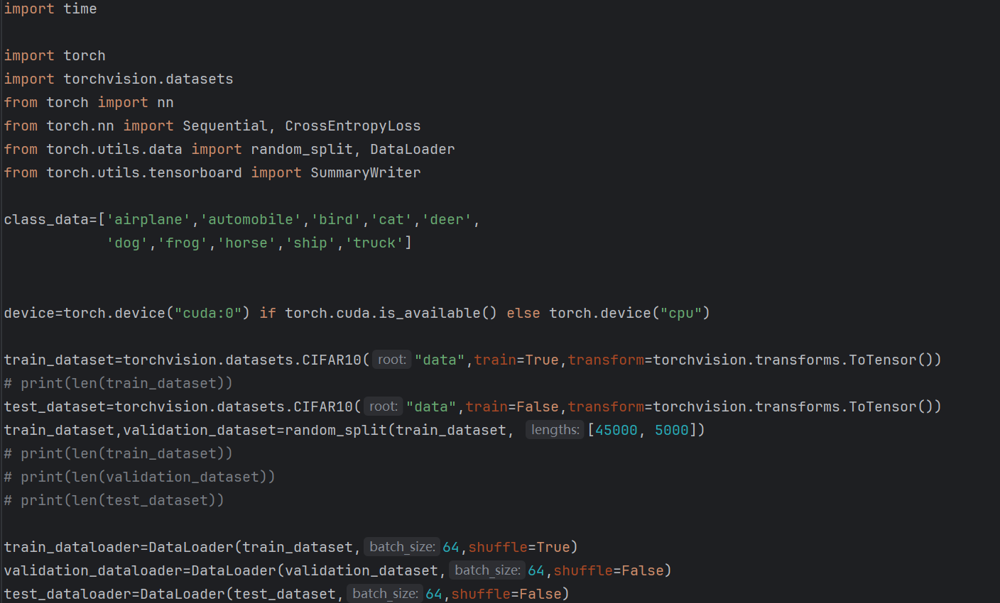

> 该图为数据集dataset和dataloader设置

## 二、搭建基础的CNN架构

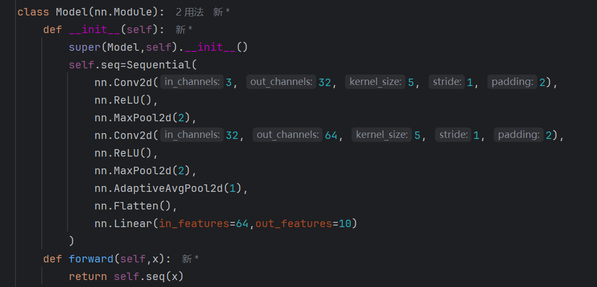

> 该图为模型核心结构

## 三、让模型move on

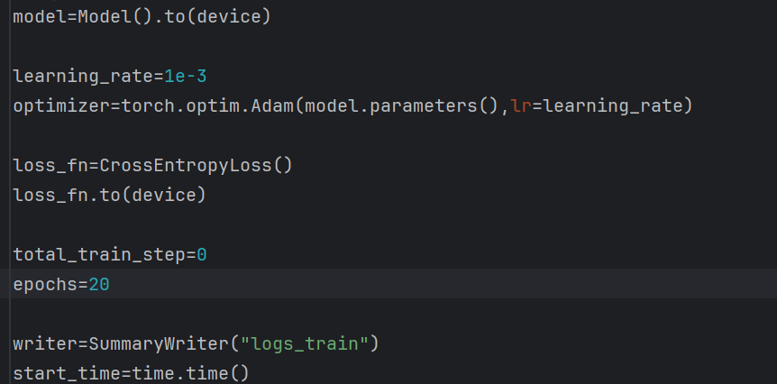

> **该图为损失函数和优化器设置，画图采用tensorboard**

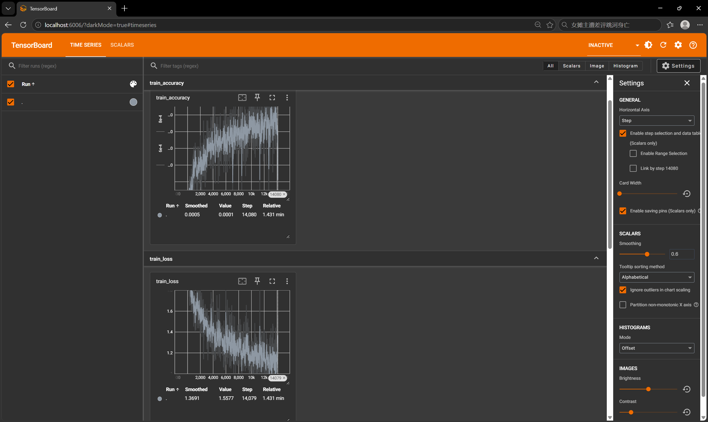
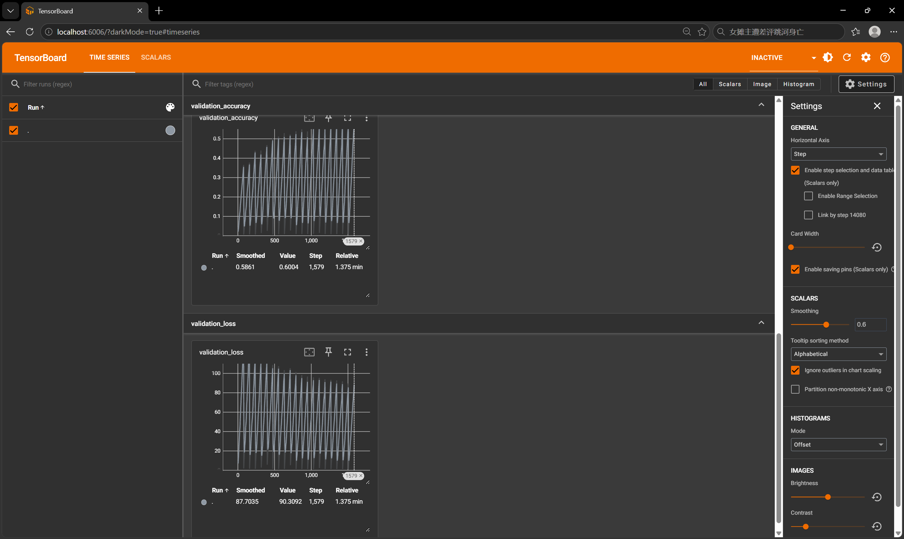

> **上两图为模型在训练集和验证集中的表现**

## 四、优化你的CNN

```python
class Model(nn.Module):
    def __init__(self):
        super(Model,self).__init__()
        self.seq=Sequential(
            nn.Conv2d(3, 32, 5, 1, 2),
            nn.ReLU(),
            nn.MaxPool2d(2),
            nn.Conv2d(32, 32, 5, 1, 2),
            nn.ReLU(),
            nn.MaxPool2d(2),
            nn.Conv2d(32, 64, 5, 1, 2),
            nn.ReLU(),
            nn.MaxPool2d(2),
            nn.AdaptiveAvgPool2d(1),
            nn.Flatten(),
            nn.Linear(in_features=64,out_features=10)
        )
    def forward(self,x):
        return self.seq(x)
```

- 添加了一层**32to32**的卷积层和ReLU激活函数和maxpool池化，增加模型复杂度，相同条件下均训练20次，得到结果如下

| 模型         | 验证集准确率       | 测试集准确率       | 参数量 |
| ------------ | ------------------ | ------------------ | ------ |
| 基础 CNN     | 0.6003999710083008 | 0.6057999730110168 | 54346  |
| 改进后的 CNN | 0.6995999813079834 | 0.7035999894142151 | 79978  |

## 五、模型到底看懂了吗？

- 模型为什么容易混淆猫和狗？ 问题可能来自图片分辨率、训练数据，还是模型结构？
  1. **图片分辨率**：32×32 像素太小，动物细微特征（胡须、脸型）丢失，人眼看小图有时也分不清猫和狗。
  2. **训练数据**：数据集里猫、狗姿态多样，部分图片背景杂乱，有些图片动物占比很小，增加识别难度。
  3. **模型结构**：该模型CNN 只有 3 层卷积，网络容量有限，提取高级细粒度区分特征的能力不足，很难学到猫、狗之间微小差异

- 以下为预测正确的图片：
- 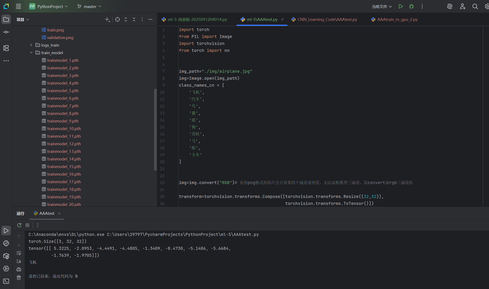
- 
- 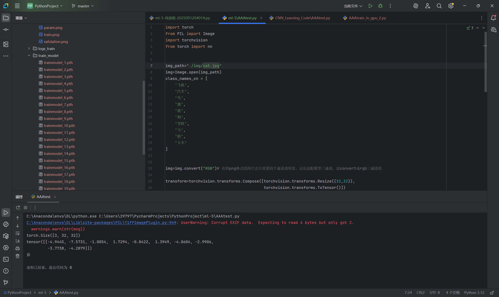
- 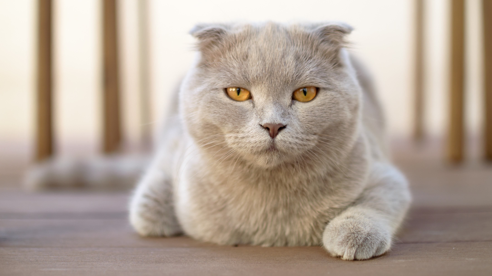

- 以下为预测错误的图片：
- 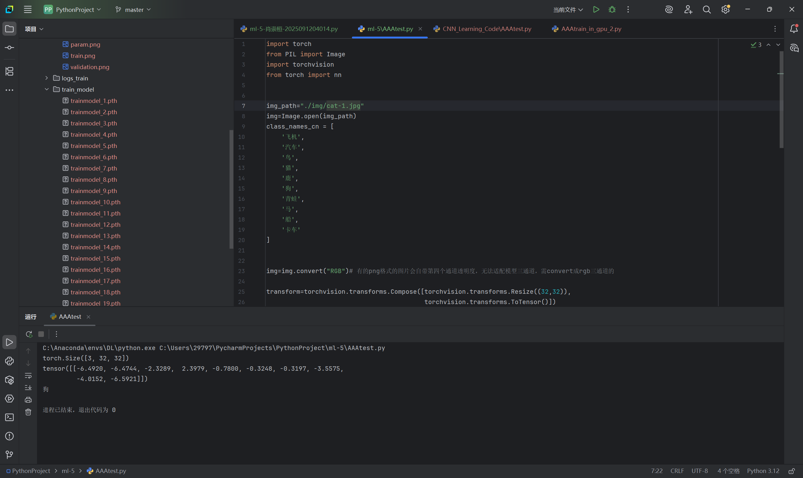
- 

整体混淆矩阵如下图
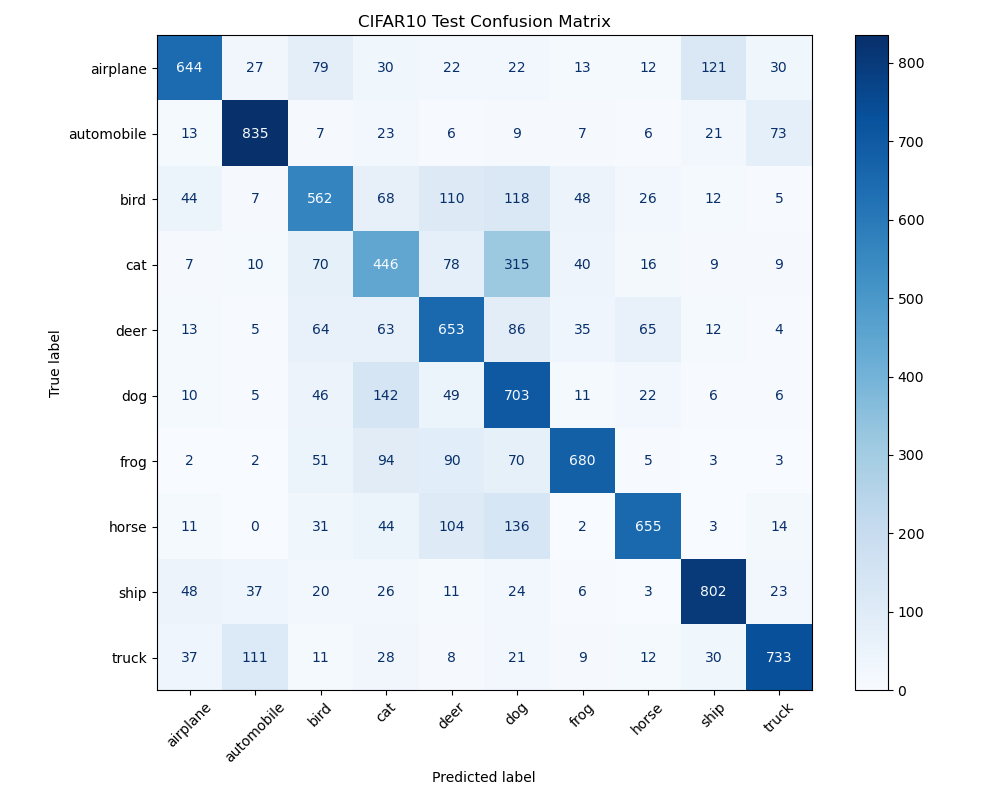

## 六、拓展挑战

- 可视化第一层卷积核如下图
  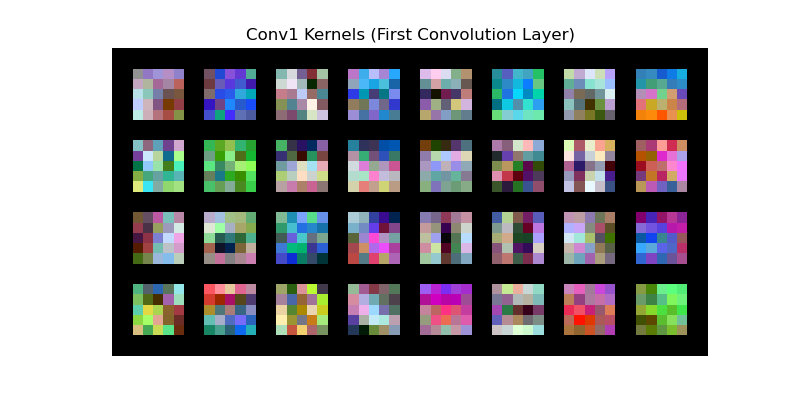

## 七、关于AI使用

- 这次任务中我只在画卷积核和混淆矩阵中借助了ai的帮助
