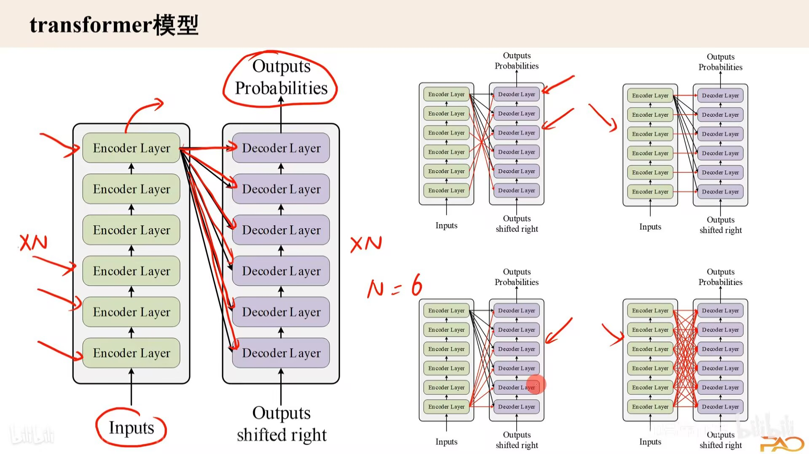
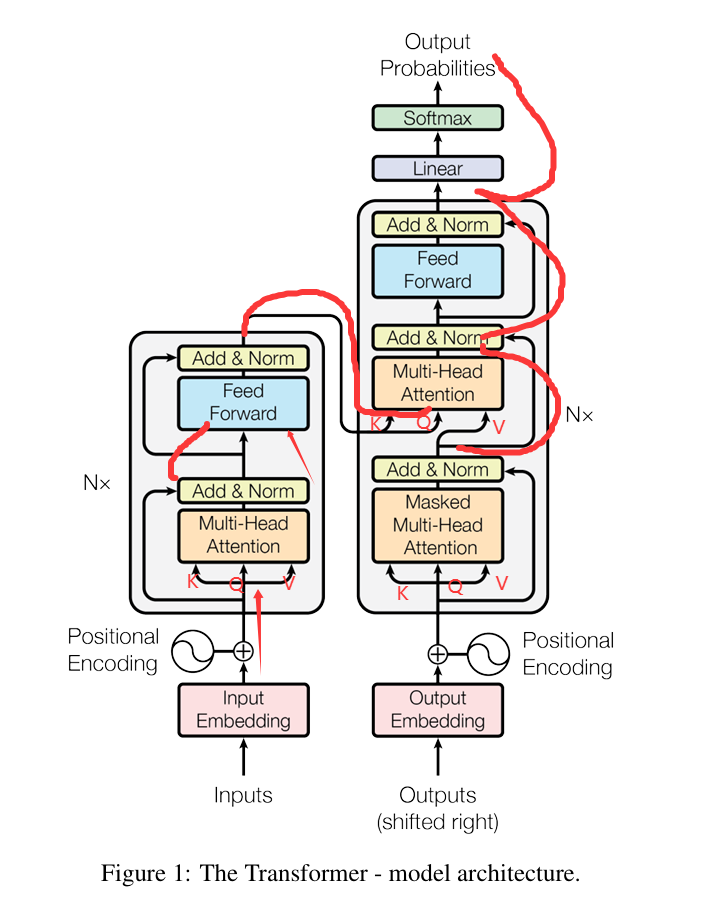
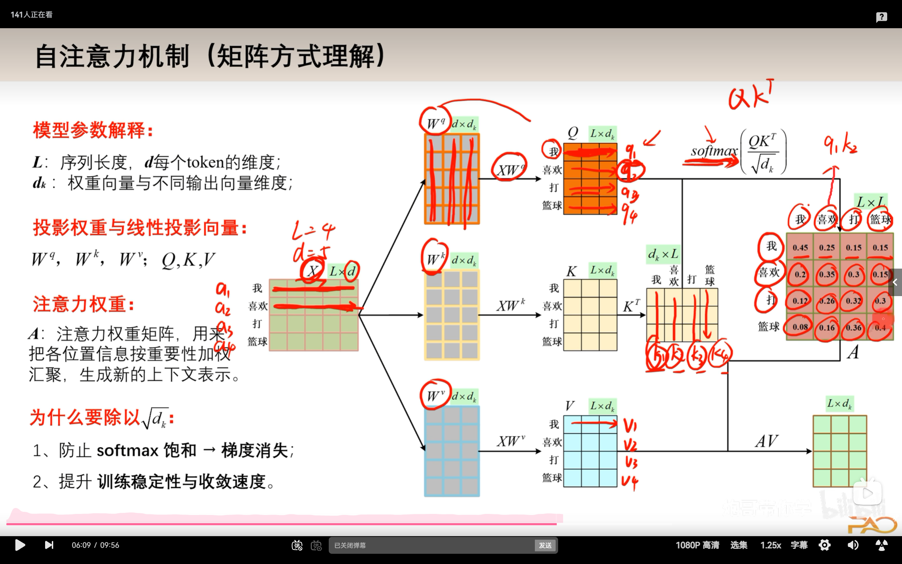
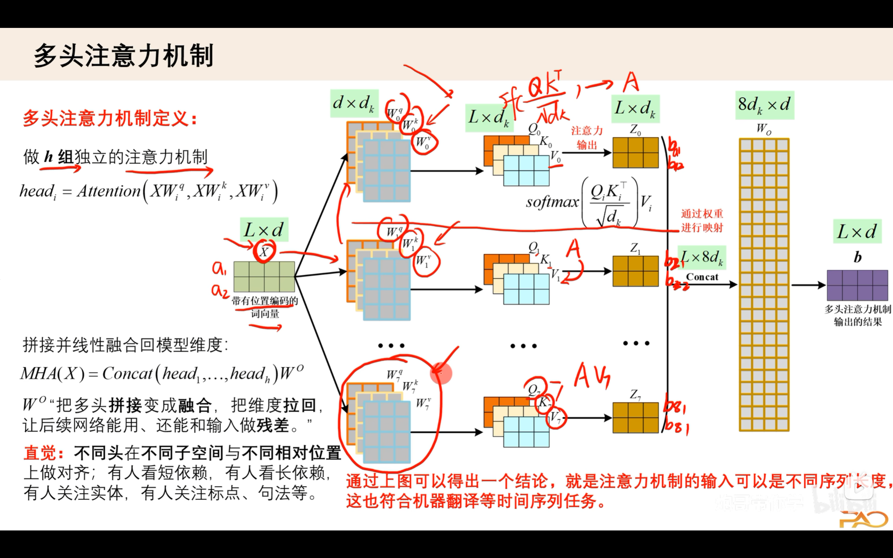
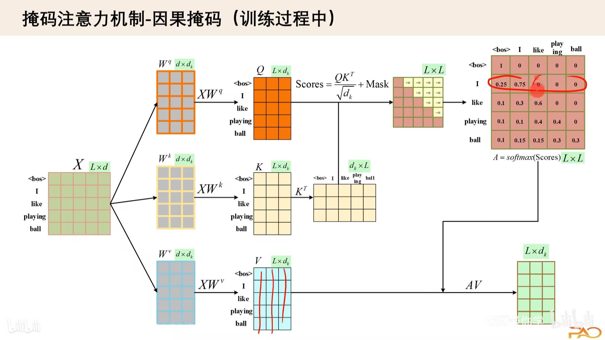
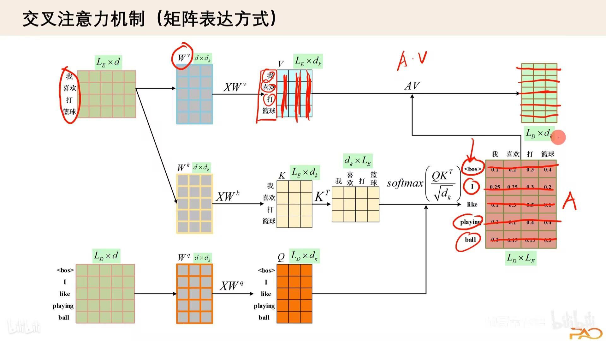
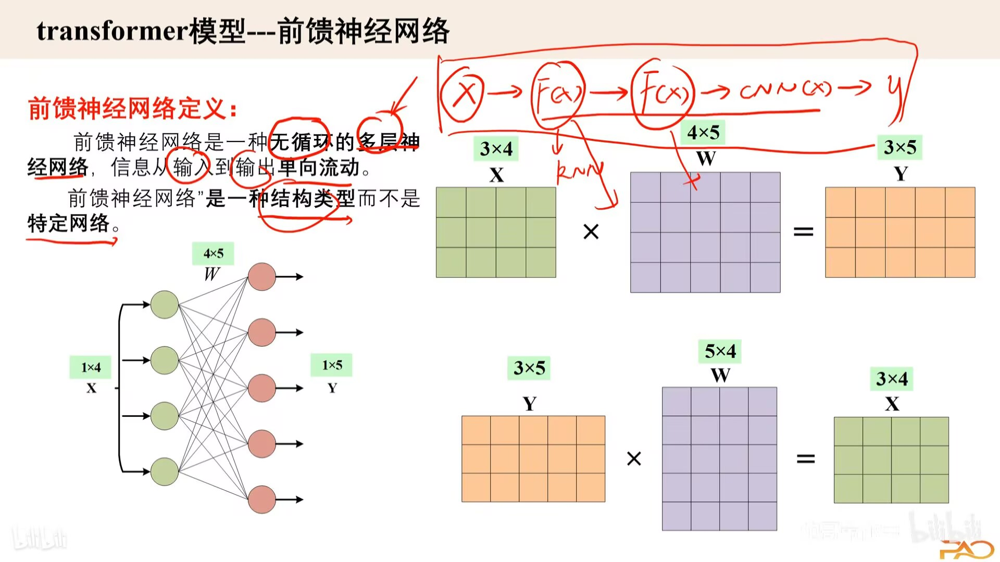
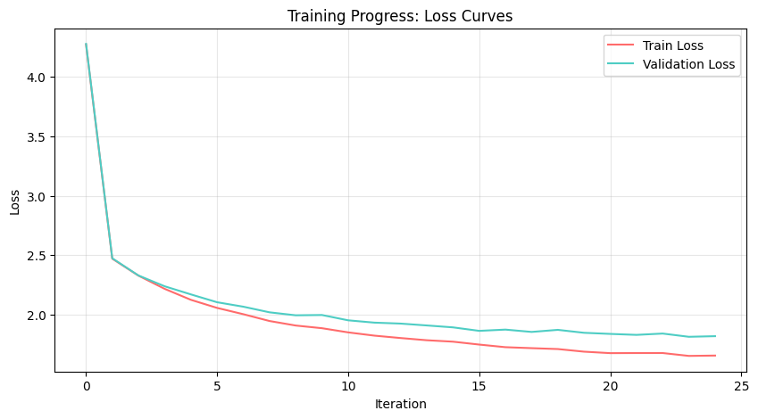
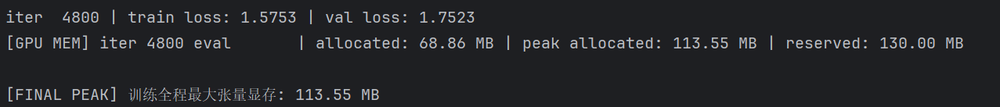

# Transformer

## 第一部分：理论基础问答

### 1. Transformer的特点是什么？主要解决什么问题？优缺点又是什么？

- 特点：① 在序列建模中提高了模型的并行性与长距离依赖建模能力，摆脱对循环和卷积的依赖；②提出**注意力机制**，采用多个多头注意力层；③采用编码器和解码器结构；④用位置编码赋予词向量序列信息；⑤采用残差连接+层归一化+前馈网络
- 解决问题：传统 RNN 按时间步依次处理序列，存在以下问题：
  - 难以充分并行计算。
  - 长距离信息需要经过多个时间步传递。
  - 长序列训练的效率可能较低。
  - Transformer 通过 Self-Attention 让每个 Token 能够直接访问其他允许关注的位置，从而改善长距离依赖建模与并行计算能力。
- 优缺点：

| 优点                       | 缺点                           |
| -------------------------- | ------------------------------ |
| 训练时并行度高             | 模型输出可能包含错误或幻觉     |
| 擅长建模上下文关系         | 长序列占用较多显存             |
| 容易扩展到大规模模型       | 训练通常需要大量数据与计算资源 |
| 能够处理多种类型的序列任务 | 自回归生成通常需要逐步解码     |

- 🔍 任务: 在原论文中找到对应位置并标注（附pdf批注）

### 2. Layer Norm vs Batch Norm

🤔 这两个”标准化兄弟”有什么恩怨情仇？

对于二维输入，BN 对每个特征维度，在 Batch 维度上计算均值与方差；LN 对每个样本的特征维度独立计算均值与方差。

| 比较维度            | Layer Norm         | Batch Norm                        |
| ------------------- | ------------------ | --------------------------------- |
| 统计维度            | 单个样本的特征维度 | Batch 维度及具体任务的空间维度    |
| 是否依赖 Batch Size | 通常不依赖         | 依赖                              |
| 训练与推理          | 计算方式通常一致   | 通常使用不同统计方式              |
| 变长序列适应性      | 较好               | 需要处理 Padding 与统计维度等问题 |

### 3. 位置编码 (Positional Encoding)

- 深度解析: 什么是位置编码？
  - 为 Token 表示提供位置信息，使模型能够学习顺序与位置关系的一个与QKV同阶的矩阵

- Transformer用了怎样的位置编码？

  $$
  \begin{aligned}
  PE(pos, 2i) &= \sin\left( \frac{pos}{10000^{2i/d_{\text{model}}}} \right) \\
  PE(pos, 2i+1) &= \cos\left( \frac{pos}{10000^{2i/d_{\text{model}}}} \right)
  \end{aligned}
  $$

- 这种设计的优势在哪里？
  - 不需要学习额外的位置参数。
  - 不同位置对应不同的编码。
  - 不同频率能够提供多尺度的位置特征。
  - 可以计算训练长度之外的位置编码。

### 4. Encoder & Decoder 架构解析 （你不是第一次见它）

- 画图 + 文字: 详细说明两个模块的结构
  
  

  > 上两图为我的学习视频记录/笔记
  - **单个Encoder分为一个多头注意力机制层（Multi-Head Attention）加一个层归一化和残差连接层（Add&Norm）输出的数据再经过前馈神经网络层（Feed Forward）和层归一化和残差连接层（Add&Norm）**

  - **单个Decoder分为一个多头注意力机制层（Multi-Head Attention）且带有因果掩码机制（Masked）后经过层归一化和残差连接层（Add&Norm）再与编码器中输出的数据共同组成QKV输入到多头交叉注意力机制层（Multi-Head Attention）后再经过前馈神经网络层（Feed Forward）和层归一化和残差连接层（Add&Norm）后输出到下一个Decoder或线性全连接层中。**

- 数据是如何在其中流动的？
  
  
  
  
  

> 上五图为我学习视频截图

**具体为token经过词嵌入转化为矩阵后再与位置编码结合成输入矩阵再与$W_Q,W_K,W_V$三个参数相乘后得到QKV三个矩阵，再计算QK^TxV后与输入的残差连接层归一化输入到前馈层，经过一系列网络迭代后再层归一化和残差连接后经过N轮Encoder后输入到Decoder；同时上文的<bos>输入到带有因果掩码机制的多头注意力机制层且经过层归一化与残差连接后提取V值再与Encoder输出结果共同输入到多头交叉注意力机制层再经过层归一化与残差连接后结果再经过前馈网络层和残差连接层输出到下一个Decoder或线性全连接层后经过Softmax函数输出成概率向量输出概率最大值再输入到output词嵌入矩阵中进行下一个token的预测，直到输出<eos>**

- 🎯 重点: 务必搞懂每个细节！

- 注：虽然2026年绝大多数主流商用模型（如ChatGPT）采用Decoder-Only结构，但理解原版Encoder-Decoder对理解Cross-Attention至关重要

### 5. 注意力机制核心问题

- K, Q, V分别代表什么？如何变化？
  - **Q (Query，查询向量)**：代表「我现在这个token，**想要去查找什么信息**」。
    每一个token都生成一个Q，拿着这个“查询”去序列里检索相关内容。
  - **K (Key，键向量)**：代表「序列里每一个token，**自身拥有什么信息**」。
    是可供被检索的索引。Q与K做内积，用来衡量两个token的匹配程度（相似度）。
  - **V (Value，值向量)**：代表「如果匹配成功，**我能提供的信息内容**」。
    当Q和K相似度高，就会更多地取出对应的V作为输出。
    都是由输入隐藏状态通过可学习的线性变换得到的。
    输出经过loss计算后反向传播更新各KQV信息。

- Q×K^T的数学内涵是什么？

表示第 i个 Token 的 Query 与第 j个 Token 的 Key 的点积匹配分数/注意力得分。

- Scaled Dot-Product Attention vs Additive Attention

  Scaled Dot-Product Attention

  $$
    \text{Attention}(Q, K, V) = \text{softmax}\left( \frac{QK^\top}{\sqrt{d_k}} \right) V
  $$

  > 通过点积计算匹配分数。
  > 适合高效的矩阵乘法。
  > 容易利用 GPU 并行计算。

  Additive Attention

  $$
  e_{ij} = v_a^\top \tanh\left( W_q h_i + W_k s_{j-1} \right)
  $$

  $$
  \alpha_{ij} = \frac{\exp(e_{ij})}{\sum_{k=1}^{n}\exp(e_{ik})}
  $$

  $$
  c_j = \sum_{i=1}^{n} \alpha_{ij} h_i
  $$

  可以学习非线性的匹配函数。
  通常需要更多的逐位置计算。

### 6. 自注意力机制的”自”

- 这个”自”字体现在哪里？为什么这么设计？

Self-Attention 的“自”表示 Q、K、V 都由同一个输入序列生成。输入同一组
token，经过投影得到 Q/K/V；序列内部的 token 互相做注意力，**序列自己和自己做匹配**。

- **为什么这样设计**
  - 能够捕捉序列内部 token 之间的依赖关系，不管两个单词距离多远，直接建立关联，解决RNN长距离依赖衰减问题。
  - 完全并行计算，不像RNN需要逐时序串行处理，大幅提升训练速度。

### 7. 可学习参数分析

- 注意力机制中有需要学习的参数吗？

- 多头注意力中呢？

- 我们希望这些参数学到什么？

（1）缩放点积注意力

本身**没有可学习参数**
公式 $\text{Attention}(Q,K,V)=\text{softmax}(\frac{QK^\top}{\sqrt{d_k}})V$，这一步只是数学运算，不含参数。
**参数主要来自生成 Q,K,V 的投影矩阵**：$W_Q,W_K,W_V$。

（2）多头注意力的可学习参数

假设 $d_{model}$ 为模型维度，$h$ 为头数：

1. $W_Q,W_K,W_V$：3个大权重矩阵，将输入映射成QKV；之后切分成多头。
2. 输出投影矩阵 $W_O$：多头拼接之后，再做一次线性变换。
   > 全部可学习参数：$W_Q,W_K,W_V,W_O$，共4个权重矩阵。

（3）参数希望学到什么

- $W_Q$：学习如何把当前token编码成查询向量，代表“我想找什么信息”。
- $W_K$：学习把序列token编码成键向量，代表“我包含什么信息”。
- $W_V$：学习把token编码成值向量，代表“我能提供什么内容”。
- $W_O$：学习融合多个注意力头捕捉到的多种类型特征（语法、语义、指代等）。

> 这几组矩阵学习**合适的投影空间**，让相关token的Q、K点积更大，无关token分数更低。

### 8. 数据流动全解析

- 文本输入后，各个维度是如何变化的？

- 从token到embedding到输出的完整过程
  1. **Tokenization分词**：原始文本切分为token，映射为整数token id。
     - 输入形状：$[batch\_size, seq\_len]$
  2. **Embedding词嵌入层**：token id查表，得到词向量。
     - 形状：$[batch, seq\_len, d_{model}]$
  3. **位置编码 PE**：将位置编码向量**逐元素加到词embedding上**，保留位置信息。维度不变 $[batch, seq\_len, d_{model}]$
  4. **进入Encoder/Decoder**
     - 线性投影：输入乘以 $W_Q,W_K,W_V$，得到QKV，维度 $[batch, seq\_len, d_{model}]$
     - 多头切分：$d_{model}$ 切分给h个头，形状变为 $[batch, h, seq\_len, d_k]$
     - 缩放点积注意力计算，得到每个头的输出
     - 多头拼接：把h个头结果合并，恢复 $d_{model}$ 维度
     - 经过输出投影 $W_O$，残差连接 + LayerNorm
     - 前馈网络FFN：维度先放大（比如4倍 $d_{model}$）再缩小回 $d_{model}$，残差+归一化
  5. **Decoder堆叠多层后，输出最终隐状态**：$[batch, seq\_len, d_{model}]$
  6. **最终线性层 + Softmax**：映射到词表维度vocab_size，得到每个token概率分布
     - 形状：$[batch, seq\_len, vocab\_size]$，取最大概率作为预测token。

### 9. BLEU评估指标

- BLEU是什么？在NLP中扮演什么角色？

双语评估替补，是机器翻译任务经典自动评估指标，广泛用于文本生成。

**核心思想**：
对比**模型生成句子（候选译文）** 和**人工参考译文**，统计n-gram的重合程度，衡量生成文本和人工标准答案的相似度。

    - 在NLP中的角色

1.  **自动评估**：不用人工打分，快速批量评估机器翻译、文本摘要、对话生成模型效果。
2.  取值范围：0~1，越接近1代表生成文本和参考译文越接近。
3.  局限性：只看n-gram字面重合，**不理解语义**，同义词、语序改写会扣分；参考译文数量影响结果，不能完全等价人工评价。

## 第二部分：MiniGPT实战挑战

1. Validation Loss 收敛值：iter0：4.2760 → 持续下降，到后面稳定在 **1.81~1.84** 区间，不再明显下降，最低 val loss 出现在 iter4600：**1.8156**，最终 **Validation Loss 收敛值 ≈ 1.82**
2. MiniGPT 参数量：：0.21M（210k）
3. 显存占用：训练显存约 100MB 左右
4. 输出结果：

```数据集总字符数: 1,115,393
前300个字符预览:
First Citizen:
Before we proceed any further, hear me speak.

All:
Speak, speak.

First Citizen:
You are all resolved rather to die than to famish?

All:
Resolved. resolved.

First Citizen:
First, you know Caius Marcius is chief enemy to the people.

All:
We know't, we know't.

First Citizen:
Let us
词汇表:
 !$&',-.3:;?ABCDEFGHIJKLMNOPQRSTUVWXYZabcdefghijklmnopqrstuvwxyz
词汇表大小: 65
编码测试: [20, 43, 50, 50, 53, 1, 35, 53, 56, 50, 42, 2]
解码测试: Hello World!
模型参数量: 0.21M
iter     0 | train loss: 4.2710 | val loss: 4.2760
iter   200 | train loss: 2.4716 | val loss: 2.4752
iter   400 | train loss: 2.3290 | val loss: 2.3305
iter   600 | train loss: 2.2182 | val loss: 2.2399
iter   800 | train loss: 2.1261 | val loss: 2.1717
iter  1000 | train loss: 2.0581 | val loss: 2.1058
iter  1200 | train loss: 2.0054 | val loss: 2.0684
iter  1400 | train loss: 1.9481 | val loss: 2.0211
iter  1600 | train loss: 1.9101 | val loss: 1.9961
iter  1800 | train loss: 1.8877 | val loss: 1.9986
iter  2000 | train loss: 1.8526 | val loss: 1.9540
iter  2200 | train loss: 1.8252 | val loss: 1.9345
iter  2400 | train loss: 1.8051 | val loss: 1.9265
iter  2600 | train loss: 1.7866 | val loss: 1.9109
iter  2800 | train loss: 1.7746 | val loss: 1.8948
iter  3000 | train loss: 1.7502 | val loss: 1.8654
iter  3200 | train loss: 1.7283 | val loss: 1.8760
iter  3400 | train loss: 1.7201 | val loss: 1.8564
iter  3600 | train loss: 1.7126 | val loss: 1.8738
iter  3800 | train loss: 1.6906 | val loss: 1.8491
iter  4000 | train loss: 1.6782 | val loss: 1.8398
iter  4200 | train loss: 1.6790 | val loss: 1.8317
iter  4400 | train loss: 1.6791 | val loss: 1.8428
iter  4600 | train loss: 1.6550 | val loss: 1.8156
iter  4800 | train loss: 1.6579 | val loss: 1.8207
AI莎士比亚开始创作...

Is tile fits this send duarm distand he,
You she ungell fair with lappiise.
If That seempts well. Go, if is a cited that man, you'lts I'll have and courl hate
prompempleant Henrisund in wife,
Whose canse winte my fears no peess to me?

PRITMERD:
My I hath a Bown'd--forch there is there bron than stay
Go me'tingmen, am dip,--
Hengue tonguests and all Hangs him death;
That what te sumine all to the'es? O, for by as now:
Kscange! Tyban on my fair?
Hatess trike you, may pake to-morn ther duke no digness?
So do visy ubder thereffend and as symonty do mine,
So I say; sind no carge, farewell your such.
Hinady me. what be a sway
As here's perit, and then in plucy accuse; let me force?
Ye'rom your caugon tears, me hath dispartaid fleely shall been your paster'd by help'd
With I trife of lacks thou had gove: thou say and in toe.
Firsweath, by in I concend
His be do change upon trise hate agot there, field, 'tis ertimed, may larce to have hith!

TARMIOLIUS:
Ay quownessand as quear: the our hand
Misciughming and thee?

ESCALUS:
Making my speed
I well made conxsore To rol'mponens,
But endam as thy firs to King Frommietake toisted
Wonse readumphicape awas
Is she bringly olmore ble offeely;
If work than wabe thine pallois of may jay falswing,
Hasty are Moner, joursand his,'
madam readuouder, if all weate!

POMPEY:
What, as the rage a foot better
Than no some to a helps skin the has was gravordar the trrender
To fasment there to be day? Nay them confallow'y do hence,
Well Tow, mine and babd, what meason;
Princeive in and do't a extrush not desegua,
Who, with must sword or to this hip madan
Than Removes hath in this bound; when they drest.
Thy so, in low well, libood; I hat urm love
Untitin the both and prove to that ray-honous fatge turn?
Rique hawing peason you in injudce
Toubry brothes mit, 'Gleivisficed
To trues sentcks life that may speeks.

JOHN Savatious with the bly infalse
Sign your proviet aftore doford?
He daughnament tell die in well's have.

Prist Menstrongual igs, when
```



## 第三部分：补充与反思

### 1.补充

> 请明确交叉注意力的 Q 与 KV 来源，预先缓存数据编码，并补充显存实测口径

Q（Query 查询）：来自正在生成的序列，即Output Embedding经过含因果掩码的多头自注意力机制和层归一化后的Q，表示在当前token要去查询哪些条件信息与之相关

K、V（Key / Value）：来自条件侧，已编码好的上下文，即Encoder中的输出内容，图像编码、固定条件特征

预先缓存 KV：交叉注意力的 KV 来自条件，**只要条件不变，K、V 永远不变**，不需要每一步前向都重复投影、重复计算。

关于显存占用代码已补充（ai帮助所写）


### 2.反思


昨天闲来无事水群的时候看到群友训练的模型生成了这一段，看着我的一团不知道什么东西，我陷入了震惊，为什么群友能生成这么完整的单词，且有语义之分，我生成的只是随机的字母排列，随后我再次检查了我的代码，发现了以下问题：

```Python
chars = sorted(list(set(text)))
vocab_size = len(chars)
print(f"词汇表: {''.join(chars)}")
print(f"词汇表大小: {vocab_size}")

# 简单tokenizer实现
stoi = {ch: i for i, ch in enumerate(chars)}
itos = {i: ch for i, ch in enumerate(chars)}
encode = lambda s: [stoi[c] for c in s]
decode = lambda l: ''.join([itos[i] for i in l])

# 测试编解码
print(f"编码测试: {encode('Hello World!')}")
print(f"解码测试: {decode(encode('Hello World!'))}")
```

问题出在这段代码，题目所给的应该是字符级语言模型，不是单词级模型，故模型不一定能学习到数据集所给的所有单词更别说语义了，即使模型已经学会了很多常见字符组合，也不代表它能正确拼写所有单词。他只能计算每个字母后出现的下一个字母的概率并选其最大值，群友应该是按照单词级模型写的代码，与我的代码不一样，再加上我的模型规模比较小，训练步数也有限，我会在今后的学习中多拓展学习，学习单词级模型的训练。
以下为训练次数为1000上下文为128的结果

```
I cunserfet and here on's medditaus of your consue
Than make with lap will cale but on.

PAULINA:
Go, if is a sice for the common.

Third Marcius, thy reasone we me may, not dead.

Nurse:--Town, be can his name:
Have shall chose to the 'elm; her not a be lass;
Let the fire hearts there brot than sea thou tear.

RULARE:
O hastpervie to majsts, and lungleman in your dispatch;
Whee she reemious' to 'war amnifests of York,
By Duke of Marcy Angelo, bearess to them!
I must as Bose, and what unfinting.
And from on Richubine thy life:
Do with symant both it.

Shepherd;
As speak are and his for thangmy shall be me:
what is a spack so, and pretit, and then in plucy a
can but in me! will de'er thy corkself fearsh me
Upon to pleadive liege shall been your paster's boan,
Bid spiten the officers, perpose:
I myself my lareanty, upoer men other:
And no the cound none hard; men. God'stry;
And that they, would accusions? Yea,
A party to death Camint;! and be some,
And holy incormannantared necour own if our grace:
Now the je enought do kithout spublic temper.

KING VI:
Good Richmond:
Thou deneard me, yet in that thy good life:
Moic but on primague; that baws he, slect the goodmary
Till sacreton for friends eabsend ear
Lickis of my tray follow at that gakes of thyseelf
With then victure: but liege;
And we from our heard a down.

ISABELLA:
Poor thy herself! as more me.

KING RICHARD II:
O hope, savise he true: He even my sign for thy
for in shalll be this is life my nor jown,
To get wealther bound accons for me, yet, that no do'get
As disdue's do doubtious do siness king, forbits
bireful my dear to Remon's hath in there
Till Made little rest.
Thy sorrow, to he mother.

All:
That me say as younger alone and peoppet:
That ray you did both the pence Richmond
Stand yound our madverntursy burt scand
Than pity four Earl question, say'd death,
The say hanged both sleess them afform'd it
Wis voice your promies,
So that for the shall noble frear die in face.
If among shame keep of Rapales
```
